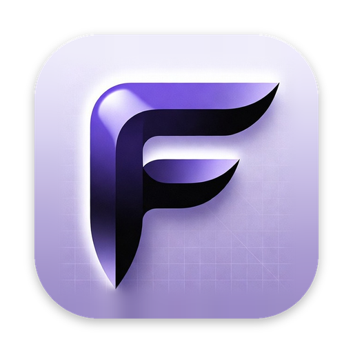
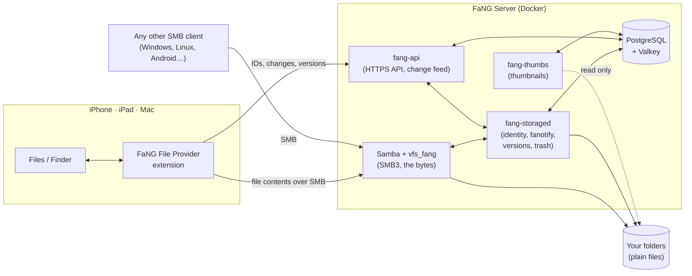

<p align="center">
  
</p>

<h1 align="center">FaNG</h1>

<p align="center">
  <strong>Files App Next Generation</strong><br>
  Your own file server, in Files and Finder, the way iCloud Drive is.
</p>

<p align="center">
  
  
  
  
</p>

---

> [!IMPORTANT]
> **FaNG is early software.** It's used every day on real data by its author, and the core (browsing, transfers, versions, trash, conflicts) has been through soak testing. But it's a young project: it isn't on the App Store, you build the app yourself with Xcode, and it has only been tested on a small number of setups. **Keep backups of anything you put on it**, as you would with any new storage software.

## Contents

- [What is FaNG?](#what-is-fang)
- [Why it was made](#why-it-was-made)
- [What sets it apart](#what-sets-it-apart)
- [Features](#features)
- [How it works](#how-it-works)
- [Try it yourself](#try-it-yourself)
  - [Requirements](#requirements)
  - [1. Set up the server](#1-set-up-the-server)
  - [2. Build and install the app](#2-build-and-install-the-app)
  - [3. Connect](#3-connect)
- [Known limitations](#known-limitations)
- [Roadmap](#roadmap)
- [Repository layout](#repository-layout)
- [License](#license)

---

## What is FaNG?

FaNG is two things that work together:

| | |
| --- | --- |
| 📱 **The FaNG app** | An app for **iPhone, iPad and Mac** that adds your server to the **Files** app and to **Finder**, next to iCloud Drive. Files download when you open them, can be kept offline, edits made offline upload when you're back, and changes from other devices show up on their own. |
| 🗄️ **FaNG Server** | A **Docker** stack that turns ordinary folders on your server into SMB shares with the things a cloud drive needs: stable file identity, a live change feed, versions, a shared trash, conflict handling, thumbnails and per-user permissions. |

The important part: **your files stay plain files in plain folders.** There's no special storage format and no database you depend on to read your own data. Any computer that speaks SMB (Windows, Linux, macOS, Android, a TV) can keep using the same shares as normal, with or without FaNG.

The app also works **without** FaNG Server, against any regular SMB share (a NAS, a Mac's File Sharing, a Linux box). It does less there, as the table below shows.

## Why it was made

Using a home server from an iPhone, iPad or Mac usually means picking one of two compromises:

- **Connect to the SMB share directly** in Files or Finder. It works, but it's a live network connection, not a cloud drive: no offline files, no "Keep Downloaded", nothing happens until you're connected, and a dropped connection interrupts what you were doing.
- **Use a self-hosted cloud app.** Many of these store your files in their own layout, need their own server stack and sync client, or have Apple apps that only partly connect to Files and Finder.

iCloud Drive shows what this can feel like when it's done properly: one location in Files and Finder that behaves like local storage, works offline, and stays in sync. Apple makes the same machinery available to every developer as the [File Provider framework](https://developer.apple.com/documentation/fileprovider) (in particular the [replicated File Provider extension](https://developer.apple.com/documentation/fileprovider/replicated-file-provider-extension)).

FaNG is the attempt to give a self-hosted server that same experience, using only Apple's public APIs, while the files themselves stay ordinary files on an ordinary SMB share.

### Why Swift on the server?

Two reasons, honestly stated:

1. **It's fast, and it's a good fit.** Swift compiles to native code, has no garbage-collector pauses, and is memory-safe. The server's daemons handle file events, transfers and change feeds for hundreds of thousands of files comfortably. It also means the app and the server are written in the same language.
2. **A small point to make.** "Apple won't let us" is a common explanation for why a self-hosted service's Apple app is missing features people ask for. Some of those limits are real, and FaNG documents the ones it runs into (see [Known limitations](#known-limitations)). But much of what people want is possible today with public, documented APIs, and other apps already show that. Building the whole thing, server included, in Apple's own language felt like a fitting way to show it.

## What sets it apart

| | SMB share in Files / Finder | FaNG app + any SMB server | FaNG app + FaNG Server |
| --- | :---: | :---: | :---: |
| Location in Files and Finder | ✅ (live connection) | ✅ (like iCloud Drive) | ✅ (like iCloud Drive) |
| Files stay plain files, usable by any SMB client | ✅ | ✅ | ✅ |
| Open files offline, "Keep Downloaded", "Remove Download" | — | ✅ | ✅ |
| Offline edits upload when back online | — | ✅ | ✅ |
| Choose it as Safari's download location | — | ✅ | ✅ |
| Interrupted transfers resume | — | ✅ | ✅ |
| Thumbnails | system | embedded previews | ✅ server-made (photos, RAW, video) |
| Changes from other devices appear on their own | — | when Files/Finder looks | ✅ live |
| Only changed parts of a file transferred | — | — | ✅ |
| Versions with preview and restore | — | — | ✅ |
| Shared trash (30 days, for every client) | — | — | ✅ |
| Conflicts kept as branches, with a "Resolve Conflict…" sheet | — | conflict copy | ✅ |
| Server-side Copy To… / Move To… | — | — | ✅ |
| Per-user permissions enforced for every SMB client | server's own | server's own | ✅ |
| Finder tags and folder icons shared between devices | — | stay on the device | ✅ |

## Features

### 📱 The app (iPhone, iPad, Mac)

One SwiftUI codebase, native on all three platforms. The app itself is only needed to add a server; everything day to day happens in **Files** and **Finder**.

- **A real location in Files and Finder**: one per server sign-in, with every share you can open as a folder.
- **Download on demand**: browse everything, download only what you open. *Remove Download* frees space; *Keep Downloaded* keeps folders available offline and downloads them in parallel.
- **Upload, rename, move, delete**, from any app that saves to Files or Finder, including Safari downloads.
- **Offline edits**: made on a plane, uploaded when you're back.
- **Resilient transfers**: interrupted uploads and downloads resume where they stopped (network drop, app killed, multi-GB video files), and a watchdog restarts transfers that stall.
- **Thumbnails** made by the server (or taken from the photo's own embedded preview on plain SMB).
- **Versions…** in the Files/Finder menu: earlier versions with previews, and *Restore*.
- **Trash**: *Move to Trash*, *Put Back* and *Delete Immediately*, through the server's shared trash.
- **Conflicts**: when two devices edit the same file, the newest save stays and the other is kept, with a red *Conflict* tag and a **Resolve Conflict…** sheet (*Use This*, *Keep Both*, *Keep Current*). The app also lists all open conflicts.
- **Copy To… / Move To…** done on the server, with progress shown on the item, so large copies don't go through your device.
- **Delta transfers**: when a big file changes a little, only the changed blocks are sent.
- **Live updates**: a change saved on one device appears on the others within seconds while FaNG is active.
- **Finder tags, folder icons and emoji** sync between devices.
- **"Not Synced" list** in the app: anything that hasn't reached the server yet, and why.
- **Secure by default**: SMB3 (encryption optional), passwords in the Keychain, and the server's certificate pinned.
- **Light on memory**: iOS gives File Provider extensions about 20 MB; FaNG streams everything and stays well below that.

### 🗄️ The server (Docker)

- **Samba for the bytes, Swift for the brains**: SMB3 file access through Samba with FaNG's own Samba module, plus Swift services for identity, change tracking, versions and the API.
- **Plain files, no lock-in**: FaNG never stores your data in its own format or changes file contents or dates to hold its information. Stop using FaNG and your folders are still just folders.
- **Stable file identity**: every file keeps its ID through renames and moves, so a rename is a rename, not a delete and re-upload.
- **Live change tracking with fanotify**: changes are picked up as they happen, whichever program made them (FaNG, another SMB client, another container on the host). No periodic rescans.
- **Change feed and WebSocket**: devices ask "what changed since last time" and get told the moment something does.
- **Versions**: earlier contents kept on the same filesystem as the file, as space-efficient clones where the filesystem supports them (for example ZFS block cloning), thinned like Time Machine (everything for a day, hourly for a week, daily for a month, weekly up to a year by default).
- **Shared trash**: deletes from any client, including plain SMB from Windows or Linux, go to a trash kept for 30 days.
- **Conflict branches**: a conflicting save becomes a branch in the file's version history, never a lost edit.
- **Thumbnails**: an isolated, unprivileged worker makes them ahead of time for images (HEIC, AVIF, JPEG XL, RAW/DNG, PSD, SVG and more) and videos (including ProRes and HDR).
- **Permissions**: rules per folder or file for users and groups, enforced for every SMB client and the API, closed by default, without touching the permissions stored on disk.
- **Home folders**: optionally, each user gets their own.
- **Server-side copies and moves**: run as background jobs, using clones where possible.
- **Admin web page**: overview (storage, health, SMB connections), shares, a file browser for setting permissions, users, groups and devices.
- **Careful with the host**: new files get the host owner and the share's permission masks, existing files keep theirs, and the container can write only inside its shares.
- **Unraid-friendly**: tested on Unraid with ZFS pools; respects Unraid's pools and user shares.

## How it works



- **File contents always travel over SMB**, the fast path on a home network. The HTTPS API carries the information around them: file IDs, what changed, versions, thumbnails.
- **Apple's File Provider system owns the syncing.** Files and Finder decide what to download, keep or evict; the FaNG extension answers quickly and correctly. There's no separate sync engine fighting the system.
- **The app finds a FaNG server by itself.** When you sign in, it looks for a hidden `fang$` share on the server. If it's there, the app signs the device in and uses the server's features; if not, it works as a plain SMB client.

## Try it yourself

### Requirements

**Server**

- A Linux machine with **Docker** and **Docker Compose** (tested on Unraid; other Linux distributions should work but are less tested).
- **Linux kernel 5.17 or newer** (for the change-tracking API FaNG uses).
- A **free IP address on your network** for FaNG. FaNG runs its own SMB server, so it gets its own address instead of sharing the host's (whose port 445 is often taken).
- Memory: the defaults allow up to 16 GB for FaNG, 24 GB for thumbnails and 12 GB for the database. These are ceilings, not reservations; lower them in `.env` on smaller machines (see below).
- Recommended: a filesystem with reflinks/block cloning (ZFS 2.2+, Btrfs, XFS) so versions take only the space of what changed. Other filesystems work, with versions stored as full copies.

**App**

- A **Mac with Xcode 27** or newer to build the app.
- Devices on **iOS 27, iPadOS 27 or macOS 27** or newer.
- An **Apple ID**. A free one works (Xcode's "Personal Team"), but apps signed that way stop opening after **7 days** and must be reinstalled from Xcode. A paid Apple Developer Program membership removes that limit.

### 1. Set up the server

**1. Get the code** on the server:

```bash
git clone https://github.com/relink2013/FaNG.git
```

```bash
cd FaNG/Server/docker
```

**2. Make your settings file** from the example:

```bash
cp env.example .env
```

Open `.env` in a text editor and set at least:

| Setting | What to put |
| --- | --- |
| `FANG_DB_PASSWORD` | A long random password for FaNG's database (you'll never type it anywhere else). |
| `FANG_LAN_NETWORK` | The Docker network on your LAN (step 3). Unraid: `br0`. |
| `FANG_IP` | The free address on your network FaNG should use, for example `192.168.1.50`. Pick one outside your router's DHCP range. |
| `FANG_SHARE_SOURCE` | The folder on the server that holds what you want to share, for example `/srv/files`. |
| `FANG_SHARE_TARGET` | Where that folder appears inside FaNG, for example `/data`. You'll use this path when adding shares. |
| `FANG_THUMBNAILS` | Where to keep thumbnails (an SSD is best). Default: `./thumbnails`. |

On a smaller machine (say 8–16 GB of RAM) also lower the limits, for example:

```ini
FANG_MEMORY=4g
FANG_THUMBS_MEMORY=4g
FANG_DB_MEMORY=3g
FANG_DB_CACHE=1GB
```

**3. Create the network** that gives FaNG its own address. *(Unraid already has one called `br0`: skip this step.)* Replace the subnet, gateway and network card name (`eth0`; see `ip link`) with your own:

```bash
docker network create -d macvlan --subnet=192.168.1.0/24 --gateway=192.168.1.1 -o parent=eth0 fang-lan
```

> [!NOTE]
> With a macvlan network, the server itself can't reach FaNG's address (other devices on the network can). That's a property of macvlan, not of FaNG.

**4. Build and start it.** The first build compiles Samba and the Swift services from source, so it can take a while (often 15–30 minutes).

```bash
docker compose build
```

```bash
docker compose up -d
```

**5. Create your first user.** The first user is also the server's admin. You'll be asked to type a password:

```bash
docker exec -it fang fang-user add yourname
```

User names are lowercase letters, digits, `-` and `_`. More users can be added later in the admin page.

**6. Open the admin page** at `https://<FANG_IP>/admin` and sign in with that user.

> [!NOTE]
> Your browser will warn that the certificate isn't trusted. That's expected: FaNG makes its own certificate on first start. The app doesn't rely on the browser's trust; it pins that exact certificate when you sign in.

**7. Add a share.** In **Shares**, choose **Add or Edit Shares…**, give the share a name and the path *inside FaNG* (for example `/data/Photos`), save, and **Apply** (FaNG restarts, about 30 seconds). You can also browse to a folder in **Files** and choose **Share This Folder…**.

**8. Give access.** A new share is hidden from everyone until you give someone access: in **Files**, open the share and add a rule for a user, a group or everyone (read, or read & write).

Optionally, set up **Home folders** so every user gets a private folder of their own.

<details>
<summary><strong>Notes for Unraid</strong></summary>

- Use `FANG_LAN_NETWORK=br0` and pick a free `FANG_IP` on your LAN.
- To share folders from several pools, set `FANG_SHARE_SOURCE=/mnt` and `FANG_SHARE_TARGET=/mnt`. FaNG mounts `/mnt` **read-only** and makes only its shares writable, so it can never create a top-level folder that Unraid would turn into a new user share.
- Add shares by their **pool or disk path** (`/mnt/<pool>/Photos`), not by `/mnt/user/...`: Unraid's user-share layer doesn't report changes or support clones.
- New files are created as `99:100` (`nobody:users`) with the share's create/directory masks, like Unraid's own Samba does.
- The compose file sets Unraid's Docker-page WebUI link and icon if you fill in `FANG_ADMIN_URL` and `FANG_ICON_URL`.

</details>

<details>
<summary><strong>Notes for other Linux hosts</strong></summary>

- FaNG creates new files and folders owned by user ID **99** and group ID **100** (Unraid's defaults). Make sure that's acceptable for your folders, or adjust `fang:uid` / `fang:gid` in `Server/docker/start.sh` and the user in `Server/docker/Dockerfile.thumbs`.
- FaNG needs to bind-mount its shares inside the container. On hosts that confine containers with **AppArmor** (Ubuntu, for example), that can be blocked; if shares show as "not served" in the admin page, adding `security_opt: ["apparmor:unconfined"]` to the `fang` service is a known workaround. Only do this if you understand the trade-off.
- Point `FANG_SHARE_SOURCE` at the real folders, not at a FUSE or network mount: change tracking needs a local filesystem.

</details>

### 2. Build and install the app

**1. Get the code** on your Mac:

```bash
git clone https://github.com/relink2013/FaNG.git
```

```bash
cd FaNG/App
```

**2. Sign in to Xcode** with your Apple ID: Xcode → Settings → Accounts → **+**.

**3. Give your copy its own identity.** Bundle identifiers are unique per Apple account, and the ones in this repo belong to another account, so pick your own (any reverse-domain name works, it doesn't need to be a real domain):

```bash
scripts/set-identity.sh com.yourname.fang
```

This replaces the identifiers everywhere they're used (the app, both extensions, the shared App Group) and sets your signing team. If it can't find your team, open `FaNG.xcodeproj` and pick your team under **Signing & Capabilities** for the `FaNG`, `FaNGProvider` and `FaNGActions` targets.

**4. Build and run.** Open `FaNG.xcodeproj`, choose the **FaNG** scheme and your Mac or a connected iPhone/iPad, and press **Run**. On an iPhone or iPad, turn on **Developer Mode** (Settings → Privacy & Security) when asked, and trust your developer certificate under Settings → General → VPN & Device Management.

Or, from the Terminal, build and install on this Mac and every connected iPhone/iPad at once:

```bash
scripts/deploy.sh
```

### 3. Connect

1. Open **FaNG** and choose **Add Server**.
2. Enter the server's **address** (your `FANG_IP`, or any SMB server), port **445**, and your **user name and password**.
3. **Test Connection** shows the shares you can open. Give the location a name and add it.
4. Open **Files** (iPhone/iPad) or **Finder** (Mac): your server is in the sidebar under *Locations*.

On a Mac, if the app connects but Finder shows "No route to host", allow FaNG under **System Settings → Privacy & Security → Local Network**.

That's it. From here on, you don't need to open the app: browsing, *Keep Downloaded*, versions, trash and conflicts all live in Files and Finder.

## Known limitations

Honest list of what isn't there yet, or can't be:

- **Not on the App Store.** You build the app yourself. With a free Apple ID it must be reinstalled every 7 days.
- **Home network first.** Away from home you need your own VPN to reach the server for now. A built-in tunnel is planned, but Apple requires a paid (and for the App Store, organization) developer account for VPN features.
- **No push notifications without a paid developer account.** On a Mac, FaNG stays current by running in the background. An idle iPhone or iPad catches up the next time Files uses FaNG.
- **Plain SMB mode is simpler**: no trash (deletes are permanent, though a delete of a file another device changed is refused), conflicts become a "… [CONFLICT date]" copy, and tags stay on the device.
- **No partial downloads on the Mac yet**: a file downloads fully before it opens (Apple only supports partial downloads on macOS, and FaNG doesn't use them yet).
- **Error badges** on items and notifications for stuck uploads aren't there yet; errors show as Files/Finder present them, plus the app's "Not Synced" list.
- **Files may need a restart after reinstalling** (iPhone/iPad): if FaNG's menu actions (Versions…, Copy To…, Move To…) are missing, force-quit Files and reopen it.
- **Share changes restart the server** (about 30 seconds; open transfers resume).
- **Large folders** are listed in one piece rather than page by page.
- **Server tested mainly on Unraid with ZFS**; Btrfs and XFS clones and other distributions are less tested.
- **No search across the server from Files/Finder yet** (planned).

## Roadmap

Each stage ends with something usable, and nothing new may break what already works.

### ✅ Foundation and app MVP

- [x] Multiplatform app for iOS, iPadOS and macOS, with a replicated File Provider extension
- [x] Browse, download on demand, Remove Download, Keep Downloaded
- [x] Upload, rename, move, delete; offline edits
- [x] Safari can use FaNG as its download location
- [x] Resumable uploads and downloads, transfer watchdog
- [x] Works against plain SMB servers, and against FaNG Server with its change feed
- [x] Live updates between devices (WebSocket)
- [x] Server: Samba with FaNG's module, Swift API and storage daemon, PostgreSQL and Valkey, in Docker
- [x] Stable file identity and fanotify change tracking
- [x] Delta transfers (only changed blocks, up and down)
- [x] Permission rules for users (groups are newer and less tested), enforced for every SMB client
- [x] Home folders, admin web page (shares, files, users, groups, devices)
- [x] Soak tests: multi-GB ProRes, folders of ProRAW, extension killed mid-transfer, airplane-mode toggles, the same file edited on two devices

### ✅ Versions, trash, conflicts and thumbnails

- [x] Versions with Time Machine–style thinning, "Versions…" sheet with previews and Restore
- [x] Shared 30-day trash for every client, Put Back and Delete Immediately
- [x] Conflict branches, red Conflict tag, "Resolve Conflict…" sheet, conflicts list
- [x] Server-made thumbnails for images, RAW and video
- [x] Server-side Copy To… and Move To… with progress
- [x] Finder tags and folder icons shared between devices

### 🔜 Server name, accounts and a public API

- [ ] A public name and real certificate next to the LAN address, with automatic fallback (in progress)
- [ ] Accounts with stable IDs, display names and pictures (in progress)
- [ ] Groups in every permission rule; rules that follow a folder when it's renamed or moved
- [ ] "Can share" and "can manage access" permission levels
- [ ] Named, scoped, revocable API tokens; an OpenAPI description of the API
- [ ] Webhooks and an event stream for other software
- [ ] Audit log; rate limits and lockouts on sign-in

### 🔜 Single sign-on (OIDC)

- [ ] Sign in to the web interface and the app with your own OIDC provider
- [ ] Account linking, and optional accounts created on first sign-in
- [ ] App passwords for plain SMB clients
- [ ] Profile pictures

### 🔜 Search

- [ ] Search the whole server from Files and Finder, not only what a device has seen
- [ ] Photo and video metadata (dates, camera, place) and document text in the index
- [ ] Finder search for Macs connected over plain SMB (Spotlight)

### 🔜 A new web interface

- [ ] A modern, live web app: files with thumbnails, search, versions, trash, sharing, devices
- [ ] A separate admin area: health, users, groups, shares, permissions with "view as user", jobs
- [ ] Shares and home folders added without a restart

### 🔜 Files over HTTPS, and links

- [ ] Downloads and resumable uploads over HTTPS where SMB can't reach
- [ ] WebDAV for standard clients
- [ ] Item links that survive renames and moves, opening in Files and Finder
- [ ] Public links with optional password, expiry and download limit
- [ ] "Copy Link" in Files and Finder

### 🔜 Sharing from Files and Finder

- [ ] "Share…" and "Manage Access…" sheets in Files and Finder
- [ ] Shared with Me and My Shares
- [ ] Notices when something is shared with you

### 🔜 Linked servers

- [ ] Share between two FaNG servers (friends and family each running their own)
- [ ] A linked server's shared items appear on your own server, for every client

### 🔜 App polish

- [ ] Per-device storage settings: thumbnail cache size and how long downloads stay local
- [ ] Status and error badges on items, notifications for stuck uploads
- [ ] Partial downloads on the Mac (large video opens before it's fully downloaded)
- [ ] Faster transfers: pipelined requests and a connection pool
- [ ] Paged directory listings for very large folders
- [ ] Quick Look previews, Share extension, Shortcuts, widgets

### 🔜 Server polish

- [ ] Runs without root on any Linux host, with narrower mounts
- [ ] Versions and trash that follow a file to another pool
- [ ] Windows "Previous Versions" over SMB
- [ ] PDF and Office thumbnails, audio cover art
- [ ] Quotas; space report per share with low-space warnings

### 🔮 Later

- [ ] Built-in WireGuard tunnel for access away from home *(needs a paid developer account)*
- [ ] Push notifications to wake devices on changes *(needs a paid developer account)*
- [ ] App Store release *(paid account, license review, privacy manifest)*
- [ ] Photo-library backends (such as Immich)
- [ ] Windows, Linux and Android apps

## Repository layout

```
App/                    The Apple app (Xcode project)
├── FaNG/               The app (SwiftUI): add servers, Not Synced, conflicts, copies
├── FaNGProvider/       The File Provider extension (what Files and Finder talk to)
├── FaNGActions/        The File Provider UI extension: Versions…, Resolve Conflict…, Copy To…, Move To…
├── FaNGKit/            Shared Swift package: SMB backend, API client, item store, keychain
├── FaNGTests/, FaNGUITests/
├── Vendor/AMSMB2/      SMB client library (with a few documented patches, see FANG-PATCHES.md)
└── scripts/            set-identity.sh, deploy.sh

Server/                 FaNG Server (Swift package + Docker)
├── Sources/
│   ├── FaNGCore/       Shared server code: config, database, items, permissions, versions
│   ├── fang-api/       HTTPS API, change feed, WebSocket, admin page
│   ├── fang-storaged/  The storage daemon: identity, fanotify, versions, trash, copies
│   ├── fang-thumbs/    Thumbnail worker
│   └── CLinuxFS/       Small C helpers for Linux filesystem calls
├── samba/vfs_fang/     FaNG's Samba module
├── Tests/
└── docker/             Dockerfiles, docker-compose.yml, env.example, start script, fang-user
```

Run the tests with `swift test --package-path App/FaNGKit` and `swift test --package-path Server`.

## License

FaNG is released under the [MIT License](LICENSE).

It builds on other open-source work, which keeps its own license:

- [AMSMB2](https://github.com/amosavian/AMSMB2) and [libsmb2](https://github.com/sahlberg/libsmb2), the SMB client (LGPL 2.1), vendored with the changes listed in [`FANG-PATCHES.md`](App/Vendor/AMSMB2/FANG-PATCHES.md)
- [Samba](https://www.samba.org) (GPL 3.0), downloaded and built into the server image
- [Hummingbird](https://github.com/hummingbird-project/hummingbird), [PostgresNIO](https://github.com/vapor/postgres-nio), [SwiftNIO SSL](https://github.com/apple/swift-nio-ssl), [Swift Crypto](https://github.com/apple/swift-crypto), [PostgreSQL](https://www.postgresql.org) with [pgvector](https://github.com/pgvector/pgvector), [Valkey](https://valkey.io), [libvips](https://www.libvips.org), [FFmpeg](https://ffmpeg.org) and [ExifTool](https://exiftool.org)

FaNG isn't affiliated with or endorsed by Apple. iPhone, iPad, Mac, Finder and iCloud are trademarks of Apple Inc.
