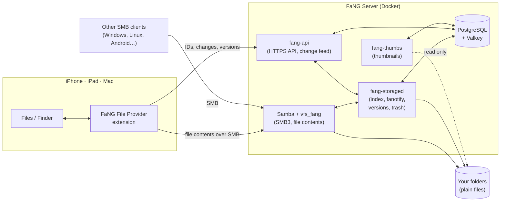

<p align="center">
  
</p>

<h1 align="center">FaNG</h1>

<p align="center">
  <strong>Files App Next Generation</strong><br>
  Your own server in Files and Finder. Fast browsing, thumbnails that keep up, and folders that download at full speed.
</p>

<p align="center">
  
  
  
  
</p>

---

> [!IMPORTANT]
> **FaNG is new.** I use it every day with real data, and the core has held up under long, deliberately rough tests: multi-gigabyte video files, folders of hundreds of RAW photos, transfers cut off halfway, Wi-Fi dropping mid-upload, and the same file edited on two devices at once. It has still only run on a handful of setups, and some features are newer than others (marked 🧪 below). Keep backups of anything you put on it, as you would with any new storage software.

## Contents

- [What is FaNG?](#what-is-fang)
- [What makes it different](#what-makes-it-different)
- [Features](#features)
- [How it works](#how-it-works)
- [Quick start](#quick-start)
- [Detailed setup](#detailed-setup)
- [Known limitations](#known-limitations)
- [Roadmap](#roadmap)
- [Repository layout](#repository-layout)
- [License](#license)

## What is FaNG?

FaNG has two parts.

**The FaNG app** for iPhone, iPad and Mac puts your server in the sidebar of the Files app and Finder, as a location of its own. You browse everything on the server, files download when you open them, folders can be kept offline, and changes made on one device show up on the others within seconds.

**FaNG Server** is a Docker stack that serves your existing folders. It includes its own SMB file server (built on Samba) plus the pieces that make the app fast and safe: an index of every file, live change tracking, thumbnails, versions, a shared trash, conflict handling and per-user permissions.

On disk, your files stay ordinary files in ordinary folders. FaNG doesn't convert them into its own storage format, and it never changes a file's contents or dates to store its own information. Computers without the app (Windows, Linux, Android, a TV) connect to FaNG Server over SMB like any other file server. And if you ever stop using FaNG, the folders are simply still there.

## What makes it different

Everyone knows what a file browser does. These are the parts FaNG cares most about:

- **Browsing feels local, even on an iPhone.** The server keeps an index of every file and tells devices what changed, so opening a folder doesn't mean crawling the share over the network. Large folders open about as fast as folders on the device.
- **Thumbnails that actually show up.** The server makes thumbnails ahead of time, as files arrive, for photos (HEIC, RAW/DNG, AVIF, JPEG XL, PSD and more) and videos (including ProRes and HDR). Scroll through a folder of thousands of photos and the previews are already there.
- **Bulk downloads at full speed.** Downloads run in parallel (up to 16 at once on a Mac, 4 on iPhone and iPad to stay inside iOS's memory limit for this kind of app). Large files are split into pieces fetched over several connections. When an app opens files from a folder one after another, FaNG fetches the next ones ahead of time. SMB encryption was reworked to run about 30 times faster, so it no longer holds transfers back.
- **Changes arrive almost instantly.** Devices keep a live connection to the server while FaNG is in use. Save a file on the Mac and it's on the iPad a moment later. An iPhone or iPad that has been sitting idle catches up within moments of opening Files or any app that uses FaNG.
- **Safe by design.** Earlier versions you can preview and restore, a trash shared by every device, and conflicts that never lose an edit.
- **A proper part of the system.** Everything happens in Files and Finder. You only open the FaNG app to add a server.

### Why Safari keeps coming up

Safari only lets you choose a download location that the system treats as real storage. A server connected directly in Files or Finder ("Connect to Server") can't be picked. FaNG can, so downloads from Safari on your iPhone, iPad or Mac go straight to your server. It's a simple, everyday test of whether a location is a true part of the system, and passing it was the goal of FaNG's first milestone.

### Compared with connecting to a share directly

| | Share connected in Files / Finder | FaNG app + FaNG Server |
| --- | :---: | :---: |
| Browse your server in Files and Finder | ✅ | ✅ |
| Folders open about as fast as local ones | — | ✅ |
| Thumbnails made ahead of time, photos and video | — | ✅ |
| Parallel downloads, read-ahead | — | ✅ |
| Files available offline ("Keep Downloaded"), "Remove Download" | — | ✅ |
| Edits made without a connection upload later | — | ✅ |
| Interrupted transfers pick up where they stopped | — | ✅ |
| Can be Safari's download location | — | ✅ |
| Changes from other devices appear on their own | — | ✅ |
| Versions with preview and restore | — | ✅ |
| Shared trash, kept 30 days | — | ✅ 🧪 |
| Conflicts kept, with a "Resolve Conflict…" sheet | — | ✅ |
| Copy and move run on the server, not through your device | — | ✅ |
| Finder tags and folder icons shared between devices | — | ✅ |

The app should also work with a regular SMB server (a NAS, a Mac's File Sharing, a Linux box), without FaNG Server. It then does less: no versions, trash, live changes or server thumbnails. This mode hasn't been tested much.

### Why Swift on the server?

Two reasons. First, it's fast and it's a good fit: Swift compiles to native code, has no garbage-collector pauses, and is memory-safe, and the server comfortably keeps track of hundreds of thousands of files. It also means the app and the server share one language.

Second, a small point to make. "Apple won't let us" is a common explanation for why a self-hosted service's Apple app is missing features people keep asking for. Some limits are real, but much of what people want is possible today with public, documented APIs ([Apple's File Provider framework](https://developer.apple.com/documentation/fileprovider) is what FaNG is built on), and other apps already show it. Writing the whole thing in Apple's own language, server included, felt like a fitting way to make that point.

## Features

🧪 = built and working, but newer and less tested than the rest.

### The app (iPhone, iPad, Mac)

- One location in Files and Finder per server sign-in, with every share you're allowed to open as a folder.
- Download on demand. "Remove Download" frees space; "Keep Downloaded" keeps whole folders offline and fetches them in parallel.
- Upload, rename, move and delete from any app that works with Files or Finder.
- Edits made without a connection upload on their own once the server is reachable again.
- Transfers that survive real life: if Wi-Fi drops or the system stops the app mid-transfer, uploads and downloads resume where they stopped, and stalled transfers restart on their own. Tested with files of several gigabytes.
- Server-made thumbnails, fetched 8 at a time.
- **Versions…** in the Files and Finder menu: earlier versions of a file with previews, and Restore.
- Conflicts: when two devices change the same file, the newest save stays and the other one is kept, marked with a red Conflict tag. **Resolve Conflict…** lets you use either version or keep both, and the app lists every open conflict.
- **Copy To…** and **Move To…** run on the server, with progress on the item, so copying a big folder doesn't send it through your phone.
- Finder tags, folder icons and emoji are shared between devices.
- A "Not Synced" list in the app shows anything that hasn't reached the server yet, and why.
- SMB3 with optional encryption, passwords in the Keychain, and the server's own certificate pinned.
- 🧪 Trash: Move to Trash, Put Back and Delete Immediately go through the server's shared trash. On a Mac, FaNG's trashed items appear in Finder's Trash; on iPhone and iPad, under Recently Deleted in Files.
- 🧪 Delta transfers: when a large file changes a little, only the changed blocks are sent, in both directions.

### The server (Docker)

- Samba for the file transfers, with FaNG's own Samba module, plus Swift services for the index, change tracking, versions and the API.
- Stable identity for every file, kept through renames and moves.
- Live change tracking (Linux's fanotify): changes are noticed as they happen, whatever made them, whether that's the app, another computer over SMB or another program on the server. No periodic rescans.
- A change feed and a live connection that tell devices what changed.
- Versions stored next to the file. On filesystems that support clones (such as ZFS 2.2 and newer), a version only takes the space of what changed. Older versions are thinned out over time: everything for a day, hourly for a week, daily for a month, then weekly for a year (adjustable).
- Conflicting saves become a branch in the file's history instead of a lost edit.
- Thumbnails from a separate worker that can only read your files, can't reach the network, and never writes into your folders.
- Permission rules per folder or file, enforced for every SMB client and for the app. Shares are closed by default, and the permissions stored on disk are never changed.
- Optional home folders, one private folder per user.
- Copies and moves on the server run as background jobs, using clones where the filesystem allows.
- An admin page: overview (storage, health, connected devices), shares, a file browser for setting permissions, users and devices.
- Careful with the host: new files get the host's owner and the share's permission masks, existing files keep theirs, and the container can only write inside its shares.
- 🧪 Shared trash for every client, kept 30 days. Deletes made over plain SMB from Windows or Linux go to the trash too.
- 🧪 Groups in permission rules.

## How it works



- File contents always travel over SMB, the fast path on a home network. The HTTPS API carries everything around them: file IDs, what changed, versions and thumbnails.
- Apple's File Provider system decides what to download, keep or remove, as it does for its own cloud storage. FaNG answers its requests quickly instead of running a separate sync engine alongside it.
- When you add a server in the app (by typing its address and your sign-in), the app checks whether it's a FaNG server by looking for FaNG's hidden `fang$` share. If it finds it, it signs the device in to the server and uses everything above. If not, it treats the server as a regular SMB server.

## Quick start

For people who are comfortable with Docker and Xcode. Step-by-step instructions are in [Detailed setup](#detailed-setup).

### Server

```bash
git clone https://github.com/relink2013/FaNG.git
cd FaNG/Server/docker
cp env.example .env        # set the database password, network, address and folders
docker compose up -d --build
docker exec -it fang fang-user add yourname
```

Then open `https://<FANG_IP>/admin`, add a share under **Shares**, and give people access to it under **Files**.

Worth knowing:

- **FaNG gets its own IP address on your network** (a macvlan network, `br0` on Unraid) because it runs a full SMB server on port 445. Running it on the host's address with other ports is possible, see [Other network setups](#other-network-setups).
- **Linux kernel 5.17 or newer** is required.
- **The first build takes 15–30 minutes** (it compiles Samba).
- **A new share is hidden from everyone** until you give someone access.
- **New files are owned by user 99, group 100** (Unraid's `nobody:users`).
- **Unraid:** add shares by their pool path (`/mnt/<pool>/Photos`). User shares (`/mnt/user/...`) aren't supported yet, see [Notes for Unraid](#notes-for-unraid).
- Only tested on Unraid with ZFS so far.

### App

```bash
cd FaNG/App
scripts/set-identity.sh com.yourname.fang
open FaNG.xcodeproj        # choose the FaNG scheme and a device, then Run
```

Worth knowing:

- **Needs Xcode 27** and devices on **iOS / iPadOS / macOS 27** or newer.
- `set-identity.sh` gives your copy its own bundle identifiers and signing team. The ones in the repo belong to another Apple account, so this step is required.
- **With a free Apple ID, the app stops opening after 7 days** and has to be installed again from Xcode. A paid developer account removes that limit.
- In the app, choose **Add Server** and enter `FANG_IP`, port `445`, and your user name and password.
- **On a Mac,** allow FaNG under System Settings → Privacy & Security → **Local Network**, or Finder will report "No route to host".

## Detailed setup

### Requirements

**Server**

- A Linux machine with Docker and Docker Compose.
- Linux kernel 5.17 or newer.
- A free IP address on your network for FaNG (with the default setup), outside the range your router hands out automatically.
- Memory: the default limits are 16 GB for FaNG, 24 GB for thumbnails and 12 GB for the database. They're ceilings, not reservations; lower them on smaller machines (see step 2).
- Recommended: a filesystem with clone support (ZFS 2.2 or newer) so versions take only the space of what changed. Other filesystems work, with versions stored as full copies. Btrfs and XFS should support clones too, but haven't been tested.

**App**

- A Mac with Xcode 27 or newer.
- iPhone, iPad or Mac on iOS 27, iPadOS 27 or macOS 27 or newer.
- An Apple ID. A free one works, with the 7-day limit described above.

### Set up the server

**1. Download the code** on the server:

```bash
git clone https://github.com/relink2013/FaNG.git
cd FaNG/Server/docker
```

**2. Create your settings file** from the example, then open `.env` in a text editor:

```bash
cp env.example .env
```

| Setting | What to put |
| --- | --- |
| `FANG_DB_PASSWORD` | A long random password for FaNG's database. You won't need to type it anywhere else. |
| `FANG_LAN_NETWORK` | The Docker network that connects FaNG to your LAN (step 3). On Unraid it's `br0`. |
| `FANG_IP` | The address FaNG will have on your network, for example `192.168.1.50`. Choose one nothing else uses, outside your router's automatic (DHCP) range. |
| `FANG_SHARE_SOURCE` | The folder on the server that holds what you want to share, for example `/srv/files`. |
| `FANG_SHARE_TARGET` | Where that folder appears inside FaNG, for example `/data`. You'll use this path when adding shares. |
| `FANG_THUMBNAILS` | Where thumbnails are kept. An SSD is best. Default: `./thumbnails`. |

On a machine with 8–16 GB of memory, also lower the limits, for example:

```ini
FANG_MEMORY=4g
FANG_THUMBS_MEMORY=4g
FANG_DB_MEMORY=3g
FANG_DB_CACHE=1GB
```

**3. Create the network** that gives FaNG its own address. Unraid already has one (`br0`), so skip this there. Replace the subnet, gateway and network card (`eth0`, see `ip link`) with your own:

```bash
docker network create -d macvlan --subnet=192.168.1.0/24 --gateway=192.168.1.1 -o parent=eth0 fang-lan
```

> [!NOTE]
> With a macvlan network, the server machine itself can't reach FaNG's address. Every other device on your network can. This is how macvlan works, not something specific to FaNG.

**4. Build and start it.** The first build compiles Samba and FaNG's services, which takes a while.

```bash
docker compose build
docker compose up -d
```

**5. Create the first user.** The first user is also the admin. You'll be asked for a password.

```bash
docker exec -it fang fang-user add yourname
```

User names can contain lowercase letters, digits, `-` and `_`. More users can be added in the admin page.

**6. Open the admin page** at `https://<FANG_IP>/admin` and sign in.

> [!NOTE]
> Your browser will warn that the certificate isn't trusted. That's expected: FaNG creates its own certificate when it first starts. The app doesn't depend on your browser's trust; it remembers that exact certificate when you sign in and refuses any other.

**7. Add a share.** Under **Shares**, choose **Add or Edit Shares…**, enter a name and the folder's path inside FaNG (for example `/data/Photos`), save, and choose **Apply**. FaNG restarts its services, which takes about 30 seconds. You can also browse to a folder under **Files** and choose **Share This Folder…**.

**8. Give access.** Under **Files**, open the share and add a rule for a user, a group or everyone (read, or read and write). Until then, nobody can see the share.

Optionally, set up **Home folders** so each user gets a private folder.

### Notes for Unraid

- Set `FANG_LAN_NETWORK=br0`, and set `FANG_IP` to an address on your LAN that nothing else uses.
- To share folders from several pools, set `FANG_SHARE_SOURCE=/mnt` and `FANG_SHARE_TARGET=/mnt`. FaNG mounts `/mnt` read-only and makes only its own shares writable, so it can never create a top-level folder that Unraid would turn into a new user share.
- **User shares (`/mnt/user/...`) aren't supported yet.** FaNG has to watch the actual disks and pools to notice changes, and the user-share layer hides those changes from it. Add each share by its pool path instead, for example `/mnt/cache/Photos` or `/mnt/<pool>/Photos`. A share whose files are spread over several disks or pools (for example cache plus array, moved by the mover) can't be served as one share today. Support for user shares is being worked on: FaNG will read Unraid's share settings, work on the real disks underneath, and show the share as one normal folder.
- New files are created as `99:100` (`nobody:users`) with the share's create and directory masks, as Unraid's own Samba does.
- Fill in `FANG_ADMIN_URL` and `FANG_ICON_URL` in `.env` to get the WebUI link and icon on Unraid's Docker page.

### Notes for other Linux hosts

These haven't been tested yet.

- New files and folders are owned by user ID 99 and group ID 100. If that doesn't suit your folders, change `fang:uid` and `fang:gid` in `Server/docker/start.sh` and the user in `Server/docker/Dockerfile.thumbs`.
- FaNG makes its shares writable inside the container with bind mounts. Hosts that confine containers with AppArmor (Ubuntu, for example) may block that. If shares show as "not served" in the admin page, adding `security_opt: ["apparmor:unconfined"]` to the `fang` service is the usual workaround, at the cost of some isolation.
- Point `FANG_SHARE_SOURCE` at local folders, not at a network or FUSE mount: change tracking needs a local filesystem.

### Other network setups

The default setup gives FaNG its own address so it can use the standard ports (445 for SMB, 443 for the API) without clashing with anything on the host. Two alternatives are possible. Neither has been tested yet.

**Docker's normal bridge network, with custom ports.** FaNG then shares the host's address, and its SMB server listens on another port, for example 1445. Every client has to be told that port: in the FaNG app it goes in the Port field, and other SMB clients use an address like `smb://server:1445`. Note that some SMB clients don't let you choose a port at all. In `docker-compose.yml`, replace the `fang` service's `networks:` block with:

```yaml
    ports:
      - "1445:445"
      - "8443:8443"
    networks:
      default: {}
      internal: {}
```

Delete the `lan:` network at the bottom of the file, and set `FANG_HTTPS_PORT=8443` in `.env` (the API's port must be the same inside and outside the container, because the app learns it from the server).

**Host networking.** FaNG is a complete SMB server, so on a machine whose own SMB server is turned off, FaNG can take over ports 445 and 443 on the host's address. This needs more changes to the compose file (the database is currently only reachable on FaNG's internal network) and isn't covered by the included file yet.

### Build and install the app

**1. Download the code** on your Mac:

```bash
git clone https://github.com/relink2013/FaNG.git
cd FaNG/App
```

**2. Sign in to Xcode** with your Apple ID: Xcode → Settings → Accounts → **+**.

**3. Give your copy its own identity.** Pick a reverse-domain name of your own. It doesn't need to be a real domain.

```bash
scripts/set-identity.sh com.yourname.fang
```

This replaces the identifiers everywhere they're used (the app, both extensions and the App Group they share) and sets your signing team. If it can't find your team, open `FaNG.xcodeproj` and choose it under **Signing & Capabilities** for the `FaNG`, `FaNGProvider` and `FaNGActions` targets.

**4. Build and run.** Open `FaNG.xcodeproj`, choose the **FaNG** scheme and your Mac or a connected iPhone or iPad, and press **Run**. On an iPhone or iPad, turn on Developer Mode when asked (Settings → Privacy & Security), and trust your developer certificate under Settings → General → VPN & Device Management.

Or build and install on this Mac and every connected iPhone and iPad at once:

```bash
scripts/deploy.sh
```

### Connect

1. Open FaNG and choose **Add Server**.
2. Enter the server's address (your `FANG_IP`), port `445` (or your custom port), and your user name and password.
3. **Test Connection** lists the shares you can open. Name the location and add it.
4. Open Files or Finder. Your server is in the sidebar under Locations.

From here on you won't need the app day to day. Browsing, Keep Downloaded, versions, trash and conflicts all live in Files and Finder.

## Known limitations

- **No TestFlight or App Store build yet.** TestFlight is planned, with no date yet. Until then the app is built with Xcode, and with a free Apple ID it has to be reinstalled every 7 days.
- **Home network first.** To reach your server from elsewhere, use your own VPN for now. A built-in tunnel is planned once the core is fully solid.
- **Large files download completely before they open.** Opening a large video on a Mac while it's still downloading is planned.
- **Unraid user shares (`/mnt/user`) aren't supported yet.** Shares have to be added by pool or disk path (see [Notes for Unraid](#notes-for-unraid)).
- **Changing shares restarts the server.** Adding or changing a share, or the home-folder setting, restarts FaNG's services (about 30 seconds; open transfers resume). Doing it without a restart is planned.
- **No item badges for errors yet.** Problems show the way Files and Finder show them, plus in the app's "Not Synced" list.
- **After reinstalling the app on iPhone or iPad,** Files may not show FaNG's menu actions (Versions…, Copy To…, Move To…) until you force-quit and reopen Files.
- **Very large folders** are fetched in one piece rather than page by page.
- **No search across the whole server from Files or Finder yet.** It's next on the roadmap.
- **Tested setups:** the server has only been tested on Unraid with ZFS. Other Linux hosts, Btrfs and XFS haven't been tested, and using the app with a regular SMB server instead of FaNG Server has only been tried lightly.

## Roadmap

Each step ends with something usable, and nothing new may break what already works.

### ✅ Done

- [x] App for iPhone, iPad and Mac, living in Files and Finder
- [x] Browse, download on demand, Remove Download, Keep Downloaded
- [x] Upload, rename, move and delete; edits made without a connection upload later
- [x] Safari can save downloads straight to FaNG
- [x] Transfers that resume after a dropped connection or a stopped app
- [x] Parallel downloads, read-ahead, fast SMB encryption
- [x] Live updates between devices
- [x] Server: Samba with FaNG's module, Swift services, PostgreSQL and Valkey, in Docker
- [x] File index with stable IDs and live change tracking
- [x] Server-made thumbnails for photos, RAW and video
- [x] Versions with previews and restore
- [x] Conflicts kept as branches, with "Resolve Conflict…"
- [x] Copy To… and Move To… on the server, with progress
- [x] Finder tags and folder icons shared between devices
- [x] Permissions per user, home folders, admin page
- [x] Long stress tests: multi-GB video, folders of RAW photos, transfers cut off halfway, Wi-Fi toggled during uploads, one file edited on two devices
- [x] 🧪 Shared trash
- [x] 🧪 Delta transfers (only changed blocks)
- [x] 🧪 Groups in permissions

### 🔜 Next

- [ ] Unraid user shares: FaNG reads Unraid's share settings and works on the disks underneath, so a share spread over cache and array looks and works like one normal folder
- [ ] Search the whole server from Files and Finder, including photo details (date, camera, place) and document text
- [ ] Finder search for Macs connected over plain SMB
- [ ] Adding and changing shares without a restart
- [ ] TestFlight builds

### 🔜 Server name, accounts and API

- [ ] A public name and certificate next to the local address, with automatic fallback (in progress)
- [ ] Accounts with stable IDs, display names and pictures (in progress)
- [ ] Permission rules that follow a folder when it's renamed or moved
- [ ] "Can share" and "can manage access" permission levels
- [ ] Named, revocable API tokens; documented API; webhooks for other software
- [ ] Audit log; limits and lockouts on sign-in

### 🔜 Single sign-on

- [ ] Sign in to the web interface and the app with your own OIDC provider
- [ ] App passwords for computers connecting over plain SMB
- [ ] Profile pictures

### 🔜 New web interface

- [ ] A modern, live web app: files with thumbnails, search, versions, trash, sharing, devices
- [ ] A separate admin area: health, users, groups, shares, permissions with "view as user", background jobs

### 🔜 Files over HTTPS, and links

- [ ] Downloads and resumable uploads over HTTPS where SMB can't reach
- [ ] WebDAV for standard clients
- [ ] Links to files that keep working after renames and moves, and open in Files and Finder
- [ ] Public links with optional password, expiry and download limit
- [ ] "Copy Link" in Files and Finder

### 🔜 Sharing from Files and Finder

- [ ] "Share…" and "Manage Access…" in Files and Finder
- [ ] Shared with Me and My Shares
- [ ] A notice when something is shared with you

### 🔜 Linked servers

- [ ] Share between two FaNG servers, for friends and family who each run their own
- [ ] A linked server's shared items appear on your own server, for every device

### 🔜 App

- [ ] Per-device storage settings: thumbnail cache size and how long downloads stay on the device
- [ ] Status and error badges on items; a notification when an upload is stuck
- [ ] Open large files on a Mac before they've finished downloading
- [ ] More throughput: several requests in flight per connection, and a connection pool
- [ ] Very large folders fetched page by page
- [ ] Quick Look previews, a Share extension, Shortcuts and widgets

### 🔜 Server

- [ ] Runs without root on any Linux host, with narrower mounts
- [ ] Versions and trash that follow a file to another pool
- [ ] Windows "Previous Versions" over SMB
- [ ] PDF and Office thumbnails, audio cover art
- [ ] Quotas; space used per share, with warnings before a disk fills up

### 🔮 Later

- [ ] Built-in tunnel (WireGuard) for access away from home
- [ ] Push notifications that wake devices the moment something changes
- [ ] App Store release
- [ ] Photo-library backends (such as Immich)
- [ ] Windows, Linux and Android apps

## Repository layout

```
App/                    The Apple app (Xcode project)
├── FaNG/               The app: add servers, Not Synced, conflicts, copies
├── FaNGProvider/       The File Provider extension (what Files and Finder talk to)
├── FaNGActions/        Menu sheets: Versions…, Resolve Conflict…, Copy To…, Move To…
├── FaNGKit/            Shared Swift package: SMB, API client, item store, keychain
├── FaNGTests/, FaNGUITests/
├── Vendor/AMSMB2/      SMB client library, with a few documented changes (FANG-PATCHES.md)
└── scripts/            set-identity.sh, deploy.sh

Server/                 FaNG Server (Swift package and Docker)
├── Sources/
│   ├── FaNGCore/       Shared server code: settings, database, items, permissions, versions
│   ├── fang-api/       HTTPS API, change feed, admin page
│   ├── fang-storaged/  Storage service: index, change tracking, versions, trash, copies
│   ├── fang-thumbs/    Thumbnail worker
│   └── CLinuxFS/       Small C helpers for Linux filesystem calls
├── samba/vfs_fang/     FaNG's Samba module
├── Tests/
└── docker/             Dockerfiles, docker-compose.yml, env.example, start script, fang-user
```

Tests: `swift test --package-path App/FaNGKit` and `swift test --package-path Server`.

## License

FaNG is released under the [MIT License](LICENSE).

It builds on other open-source projects, which keep their own licenses:

- [AMSMB2](https://github.com/amosavian/AMSMB2) and [libsmb2](https://github.com/sahlberg/libsmb2), the SMB client (LGPL 2.1), included with the changes listed in [`FANG-PATCHES.md`](App/Vendor/AMSMB2/FANG-PATCHES.md)
- [Samba](https://www.samba.org) (GPL 3.0), downloaded and built into the server image
- [Hummingbird](https://github.com/hummingbird-project/hummingbird), [PostgresNIO](https://github.com/vapor/postgres-nio), [SwiftNIO SSL](https://github.com/apple/swift-nio-ssl), [Swift Crypto](https://github.com/apple/swift-crypto), [PostgreSQL](https://www.postgresql.org) with [pgvector](https://github.com/pgvector/pgvector), [Valkey](https://valkey.io), [libvips](https://www.libvips.org), [FFmpeg](https://ffmpeg.org) and [ExifTool](https://exiftool.org)

FaNG isn't affiliated with or endorsed by Apple. iPhone, iPad, Mac and Finder are trademarks of Apple Inc.
